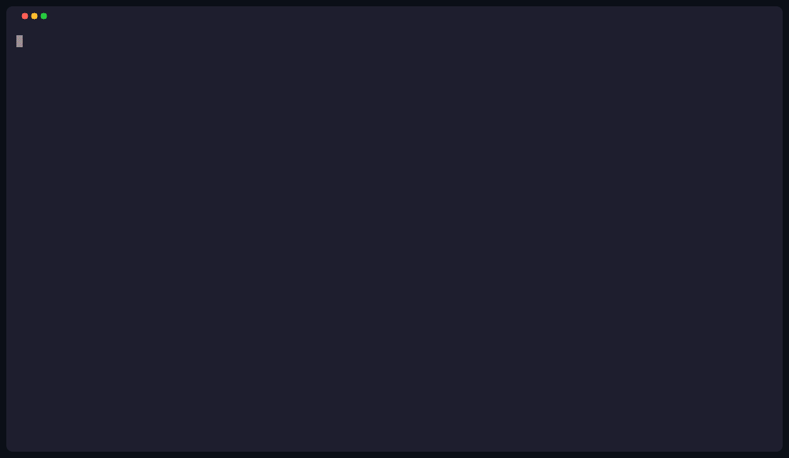

# ntnodegraph — Declarative node graphs, visual editor & MCP authoring for Bubble Tea

<p>
    <a href="https://pkg.go.dev/nimbleterminal.dev/ntnodegraph"></a>
    <a href="https://github.com/NimbleTerminal/ntnodegraph/actions/workflows/ci.yml"></a>
    <a href="./LICENSE"></a>
    <a href="./CODE_OF_CONDUCT.md"></a>
</p>

Author, validate, diff, and interactively wire declarative node graphs in a
[Bubble Tea v2](https://github.com/charmbracelet/bubbletea) terminal UI or over
the Model Context Protocol (MCP). `ntnodegraph` (`nimbleterminal.dev/ntnodegraph`)
is pure Go (`CGO_ENABLED=0`), free of host filesystem and network I/O, and runs
identically in native terminals and `GOOS=js GOARCH=wasm` browser sessions.

- **`ntnodegraph`** defines the `Spec` document model, static port type system and
  conservative coercion rules, `Registry` and `BackendProfile` validation,
  structural diffs (`Diff`), headless patch operations (`ApplyEdits`), composable
  flatten-at-load subgraphs (`graph/*`), diff-stable YAML/JSON codecs, and an
  embedded Draft 2020-12 JSON Schema (`SchemaV1JSON`).
- **`ntnodegraph/editor`** embeds a visual node-and-wire canvas in Bubble Tea v2,
  pairing antialiased [`rasterx`](https://github.com/srwiley/rasterx) vector
  rendering via [`ntpicture`](https://github.com/NimbleTerminal/ntpicture) (Kitty
  graphics with half-block glyph fallback) with Unicode cell-grid rendering via
  [`ntcanvas`](https://github.com/NimbleTerminal/ntcanvas).
- **`ntnodegraph/ngmcp`** serves transport-agnostic MCP JSON-RPC 2.0 authoring
  tools (`list`, `read`, `validate`, `edit`, `component`) and component catalog
  resources (`catalog://ntnodegraph/library`) against a pluggable `DocumentStore`.

`ntnodegraph` was extracted from [Nebula](https://github.com/NimbleTerminal/nebula),
which uses it as the declarative specification, visual Studio canvas, and MCP
authoring core for push-based media, WebGPU, WASI, and `agent/*` LLM pipelines.

[**Try the interactive browser demos →**](https://nimbleterminal.github.io/ntnodegraph/) · [Changelog](./CHANGELOG.md) · [Architecture & Invariants](./AGENTS.md)

<p>
  <a href="https://nimbleterminal.github.io/ntnodegraph/"></a>
</p>

## Install

Requires Go 1.26.8 or later.

```sh
go get nimbleterminal.dev/ntnodegraph@latest
```

To build for `GOOS=js GOARCH=wasm` or match NimbleTerminal's vector outline
renderer, include the same `replace` directives in your application's `go.mod`
(Go does not inherit replacements from dependencies):

```go
replace charm.land/bubbletea/v2 => github.com/neomantra/bubbletea/v2 v2.0.0-20261020122444-536722b0bdb6
replace github.com/srwiley/rasterx => github.com/neomantra/rasterx v0.1.1
```

## Quick start

### Parse, validate, and serialize a graph

```go
package main

import (
	"fmt"
	"log"

	"nimbleterminal.dev/ntnodegraph"
)

func main() {
	reg := ntnodegraph.NewRegistry()
	reg.MustRegister(ntnodegraph.TypeDef{
		ID: ntnodegraph.MustParseTypeID("source/timer@1"),
		Outlets: []ntnodegraph.PortDef{
			{Name: "tick", Type: ntnodegraph.TypeNumber},
		},
	})
	reg.MustRegister(ntnodegraph.TypeDef{
		ID: ntnodegraph.MustParseTypeID("surface/log@1"),
		Inlets: []ntnodegraph.PortDef{
			{Name: "in", Type: ntnodegraph.TypeAny, Required: true},
		},
	})

	raw := []byte(`
version: 1
name: demo
nodes:
  clock:
    type: source/timer@1
  out:
    type: surface/log@1
edges:
  - from: clock.tick
    to: out.in
`)

	spec, err := ntnodegraph.ParseYAML(raw)
	if err != nil {
		log.Fatal(err)
	}
	report, err := ntnodegraph.Validate(spec, reg, ntnodegraph.ValidateOptions{})
	if err != nil {
		log.Fatal(err)
	}
	fmt.Println("Topological order:", report.TopologicalOrder)
}
```

### Embed the Bubble Tea v2 visual editor

```go
import (
	tea "charm.land/bubbletea/v2"
	"nimbleterminal.dev/ntnodegraph"
	"nimbleterminal.dev/ntnodegraph/editor"
)

ed := editor.New(spec, reg, editor.Options{
	Mode:  editor.RenderVector, // or editor.RenderGrid
	Width: 100, Height: 30,
	Commit: func(next *ntnodegraph.Spec, diff ntnodegraph.SpecDiff) error {
		// Apply next/diff to your host runtime; return an error to reject & roll back.
		return nil
	},
})
```

In your host Bubble Tea model:

- Return `ed.Init()` from `Init`.
- Forward messages to `ed, cmd = ed.Update(msg)` and call `ed.SetSize(w, h)` on `tea.WindowSizeMsg`.
- Include `ed.View()` in your root `tea.View` (with `AltScreen = true` and `MouseMode = tea.MouseModeAllMotion`).
- Return `tea.Sequence(ed.Close(), tea.Quit)` on shutdown so `ntpicture` cleans up terminal image placements.

### Serve headless MCP authoring tools

```go
import (
	"nimbleterminal.dev/ntnodegraph/ngmcp"
)

store := ngmcp.NewMemoryStore("demo", map[string]*ntnodegraph.Spec{
	"demo": spec,
})

srv := ngmcp.NewServer(ngmcp.Options{
	Registry: reg,
	Store:    store,
})
// Call srv.HandleJSON(ctx, rawRequest) or srv.ServeStdio(ctx, in, out) over stdio/IPC.
```

## Core design

1. **The spec is a document, never a programming language.**
   Specs declare topology (`nodes`, `edges`), static `params`, fail-closed host
   `capabilities`, optional composable boundary ports (`inlets`, `outlets`,
   `params`), and editor-only `ui` / `groups` layout metadata. Loops,
   conditionals, expressions, and scripting belong in host node implementations,
   never in YAML/JSON.
2. **Backend-neutral validation.**
   Execution hosts supply a `BackendProfile` declaring supported namespaces
   (`source`, `transform`, `surface`, `wasm`, `gpu`, `graph`, `agent`, ...), edge
   kinds, capability kinds, and cycle-breaking rules (`CycleBreakingEdgeKinds`
   plus optional per-edge `CycleBreakingEdge` predicates such as cold-inlet state
   feedback). `ntnodegraph` itself knows nothing about clocks, schedulers, or
   host I/O.
3. **Composable subgraphs & diff-stable codecs.**
   `Library`, `Flatten`, and `ExtractSubgraph` expand `graph/<name>@<major>`
   components at load time with deterministic `instance/child` IDs and automatic
   capability roll-up. Bounded YAML and JSON parsers (`ParseLimits`) reject
   unknown fields, YAML aliases, and duplicate JSON keys; `MarshalYAML` and
   `MarshalJSON` emit byte-for-byte deterministic output for clean Git diffs.

## Packages

| Package | Description |
| --- | --- |
| `nimbleterminal.dev/ntnodegraph` | `Spec`, `TypeID`, `DataType`, `Capability`, `Registry`, `BackendProfile`, `Validate`, `EditOp` / `ApplyEdits`, `Diff`, composable `Library` / `Flatten` / `ExtractSubgraph` (`graph/*`), YAML/JSON codecs, and Draft 2020-12 JSON Schema (`SchemaV1JSON`). |
| `nimbleterminal.dev/ntnodegraph/editor` | Bubble Tea v2 visual node-and-wire canvas (`RenderVector` Kitty/half-block + `RenderGrid` `ntcanvas`), pan/zoom, port wiring, collapsible inline parameter and live preview drawers, undo/redo, group-to-subgraph promotion (`G`), and breadcrumb component drill-in (`Enter` / `Backspace`). |
| `nimbleterminal.dev/ntnodegraph/ngmcp` | Concurrency-safe, zero-I/O MCP JSON-RPC 2.0 authoring server (`list`, `read`, `validate`, `edit`, `component`, `catalog://ntnodegraph/library`) and `DocumentStore` interface (`MemoryStore` included). |

## Examples

Run the standalone examples natively in your terminal, or serve all of them in
the browser via [`booba`](https://github.com/NimbleTerminal/booba) and
`ntwebterm` (with OSC 7501 touch/action bars):

```sh
task run-editor               # visual graph editor (Vector Kitty/half-block + Grid toggle)
task run-editor -- -mode=grid # start directly in Unicode ntcanvas cell-grid mode
task run-subgraphs            # composable graph/* library, Enter drill-in, G promotion & Flatten()
task run-mcp                  # split-pane live ngmcp JSON-RPC 2.0 co-editing + canonical YAML
task serve-wasm-site          # browser showcase at http://127.0.0.1:8000/web/
```

See [examples/README.md](./examples/README.md). Examples live in a separate Go
module so browser dependencies stay outside the core library.

## Open Collaboration

Run `task ci` before submitting changes. It checks Go formatting, module
tidiness, dependency checksums, `golangci-lint`, `go vet`, race-enabled unit
tests, `GOOS=js GOARCH=wasm` builds and Node execution tests, headless browser
demo smoke checks, third-party notices, and bounded fuzzing across all eight
fuzz targets. It requires Go 1.26.8+, a C compiler for the race detector,
[Task](https://taskfile.dev), and Node.js.

```sh
task check              # vet, -race tests, js/wasm tests, site smoke checks & notices
task lint               # golangci-lint across library and examples
task fuzz               # 8 fuzz targets, 2s each (override with DURATION=30s)
task ci                 # full CI preflight matching GitHub Actions
```

Contributions and feedback are welcome. Please follow our
[Code of Conduct](./CODE_OF_CONDUCT.md).

- [Report an issue](https://github.com/NimbleTerminal/ntnodegraph/issues)
- [Submit a pull request](https://github.com/NimbleTerminal/ntnodegraph/pulls)

## Acknowledgements

Extracted from [Nebula](https://github.com/NimbleTerminal/nebula). Built on
[Charm](https://charm.land)'s Bubble Tea and Lip Gloss, Steven R. Wiley's
[`rasterx`](https://github.com/srwiley/rasterx),
[`ntcanvas`](https://github.com/NimbleTerminal/ntcanvas),
[`ntpicture`](https://github.com/NimbleTerminal/ntpicture),
[`ntfonts`](https://github.com/NimbleTerminal/ntfonts), and
[`booba`](https://github.com/NimbleTerminal/booba), with
[Kitty](https://sw.kovidgoyal.net/kitty/) and [Ghostty](https://ghostty.org)
graphics support.

## License

[MIT License](./LICENSE). Dependency and browser runtime licenses are in
[THIRD_PARTY_NOTICES.md](./THIRD_PARTY_NOTICES.md).

Copyright (c) 2026 [Neomantra Corp](https://www.neomantra.com).

----
Made with :heart: and :fire: by the team behind [Nimble Terminal](https://nimbleterminal.dev).
